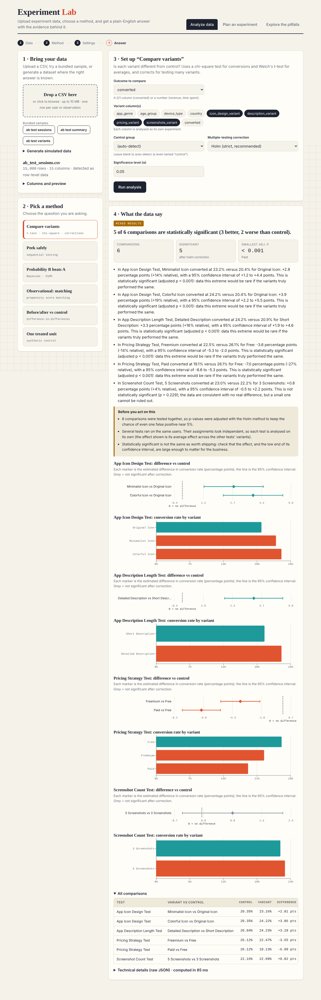

# Experiment Lab

Plan, run and interpret experiments without a statistics degree. Upload a CSV, pick a method, and get a plain-English conclusion with the
charts and caveats behind it. Covers the full path from **power analysis** to **classical tests**, **safe peeking**, **Bayesian A/B** and
**observational causal inference**.



**Demo video:** [`docs/demo/demo.webm`](docs/demo/demo.webm) (1 min 55 s walkthrough of every feature). More screenshots in [`docs/screenshots`](docs/screenshots).

## What is inside

| # | Capability | Where | Highlights |
|---|---|---|---|
| 1 | Statistics fundamentals | [`docs/01-fundamentals.md`](docs/01-fundamentals.md), `scripts/fundamentals_demo.py` | Every claim (p-value uniformity, CI coverage, power, winner's curse) checked by simulation |
| 2 | Power and sample-size service | `backend/app/stats/power.py`, `/api/power/*` | Proportions and means, MDE, power curves, Bonferroni planning, days-to-run |
| 3 | Simulation, tests, corrections | `stats/tests.py`, `corrections.py`, `simulate.py` | Chi-square, Welch t, sample-ratio check, Bonferroni, Holm, Benjamini-Hochberg |
| 4 | Sequential testing | `stats/sequential.py`, `/api/analyze/sequential` | Lan-DeMets alpha spending (O'Brien-Fleming, Pocock) plus always-valid mSPRT p-values and bands |
| 5 | Bayesian A/B | `stats/bayes.py`, `/api/analyze/bayesian` | **PyMC** posterior, P(B beats A), expected lift and loss, ROPE, exact cross-check |
| 6 | Observational methods | `stats/causal/` | Propensity matching, difference-in-differences, synthetic control; **DoWhy** and **EconML** cross-checks |
| 7 | React front end | `frontend/` | Upload, method picker, plain-English verdicts, forest/corridor/posterior/balance/placebo charts |

## Quick start

Requirements: Python 3.12, Node 22, and `g++` (lets PyTensor compile PyMC models; without it sampling still works but is slower).

```bash
make install            # virtualenv from the pinned lock file + npm ci
make backend            # API on http://localhost:8000  (Swagger UI at /docs)
make frontend           # UI on http://localhost:5173  (proxies /api to :8000)
```

Single-process, production-style (FastAPI serves the built UI):

```bash
cd frontend && npm run build && cd ../backend
../.venv/bin/uvicorn app.main:app --port 8000          # then open http://localhost:8000
```

Docker: `docker compose up --build` (single container on port 8000). See [Known limits](#known-limits-and-honest-notes) about its test status.

Configuration is by `ABLAB_*` environment variables (see `.env.example`). Set `ABLAB_WARMUP_PYMC=true` to compile the PyMC model at start-up.

## Using it

1. **Analyze data**: drop a CSV (or load a bundled sample, or generate a simulated dataset where the true effect is known), choose a method, check the pre-filled
   settings, press *Run analysis*. The answer card gives a verdict, a headline, key numbers, bullet explanations, a "before you act on this" box of caveats and charts.
2. **Plan an experiment**: how many users you need, or what effect you can detect with the traffic you have.
3. **Explore the pitfalls**: simulations showing how peeking inflates false positives (21% instead of 5%) and how corrections trade power for protection.

Expected data layouts are documented in [`docs/API.md`](docs/API.md#data-formats). The bundled `data/sample/ab_test_sessions.csv` holds 15,000 sessions from four concurrent app-store tests.

## Results at a glance

Measured, not assumed (details in [`docs/TEST_RESULTS.md`](docs/TEST_RESULTS.md) and [`docs/benchmark_results.md`](docs/benchmark_results.md)):

* **106 backend tests, 91% coverage**; 5 UI unit tests; 15 browser checks through the real UI, with no console errors.
* False-positive rate at alpha 5%: **5.1%** (chi-square), **4.9%** (Welch); 95% intervals cover **95.2%** of the time.
* Peeking 10 times at p < 0.05 with no real effect: **20.9%** false positives. Group-sequential testing: **5.2%**, at 66.6% power versus 69.3% for a single final test.
* Observational data with a true effect of 2.0: raw difference **7.19**, propensity matching **2.06** (DiD 5.04 and synthetic control 4.95 on a panel whose true effect is 5.0).
* PyMC agrees with the exact posterior to within 0.0055 in P(B beats A); latency is roughly 10 to 100 ms for classical analyses and about 1.5 s for a PyMC model (about 17 ms when the identical request is repeated).

## Repository layout

```
backend/app/stats/        pure statistics (power, tests, corrections, sequential, bayes, causal/)
backend/app/services/     datasets, experiment assembly, orchestration, plain-English narration
backend/app/routers/      HTTP endpoints
backend/tests/            106 tests
frontend/src/             React app (methods.js catalogue, components/, charts)
frontend/e2e/             Playwright smoke test and demo recorder
data/sample/              bundled example data
docs/                     architecture, API, test results, benchmarks, presentation, reflections
scripts/                  benchmarks, e2e runner, OpenAPI export, fundamentals demo
```

## Development

```bash
make test        # backend (with coverage) + front-end unit tests
make e2e         # builds the UI, boots the API, drives Chromium (needs: cd frontend && npx playwright install chromium)
make bench       # regenerates docs/benchmark_results.md
make openapi     # regenerates docs/openapi.json
```

CI (`.github/workflows/ci.yml`) runs the same three suites on every push. Commits follow conventional-commit prefixes (`feat`, `fix`, `test`, `docs`, `build`).

## Known limits and honest notes

* **Deployment.** The project is containerised (`Dockerfile`, `docker-compose.yml`) but was developed in an environment without Docker or cloud access, so the image has **not been built or deployed**. The same install steps were verified in a fresh virtualenv (all tests pass from `requirements.lock.txt`).
* **Single worker.** Uploaded data is held in memory with a TTL, so run one worker, or swap the store for Redis/object storage before scaling out.
* **No authentication.** Put it behind your proxy before exposing it.
* **Synthetic control is implemented natively** (constrained least squares with placebo inference) because neither DoWhy nor EconML provides it. DoWhy and EconML are used for matching, regression and doubly-robust cross-checks.
* **Sequential analysis on uploaded data replays history** in timestamp order. In live use, fix the maximum sample size and look schedule beforehand.
* **Bayesian analysis is for conversion (0/1) outcomes.** The mSPRT is valid at any stopping time but has low power at its default prior scale; prefer group-sequential when a maximum sample size is known.
* **Observational estimates are only as good as their assumptions** (no unmeasured confounding, parallel trends, no interference). The app states them on every result, but it cannot check them for you.

## Team deliverables

See [`docs/DELIVERABLES.md`](docs/DELIVERABLES.md) for the checklist with status, the presentation script and the reflection templates.
