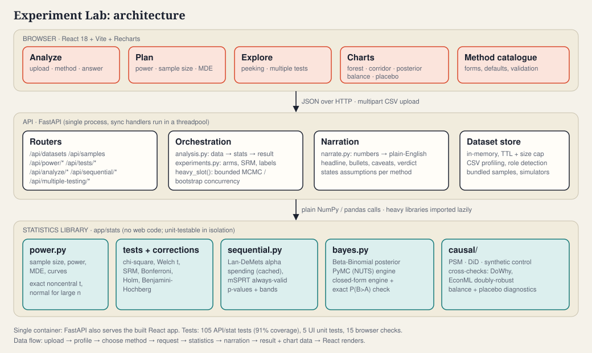

# Architecture

## Layers

1. **React front end** (`frontend/`): three tabs. *Analyze* walks through data, method and settings to a plain-English answer with charts;
   *Plan* is the power calculator; *Explore* runs simulations that show why peeking and uncorrected multiple testing go wrong. The method
   catalogue (`methods.js`) is the single place that defines each analysis's form, defaults, validation and request building.
2. **FastAPI service** (`backend/app`): thin routers validate input with Pydantic and delegate. `services/analysis.py` turns a dataset plus
   user choices into statistics, `services/narrate.py` turns numbers into prose, `services/datasets.py` profiles and stores uploads.
3. **Statistics library** (`backend/app/stats`): pure NumPy/SciPy/pandas functions with no web dependencies, which is why 58 of the tests can
   target it directly. PyMC, DoWhy and EconML are imported lazily inside the functions that need them.

## Request flow

`upload CSV` → profile (types, roles, suggestions) → user picks a method → `POST /api/analyze/<method>` → analysis module computes →
narrator writes headline, bullets and caveats → JSON (`result` + `narrative`) → React renders cards and charts. Chart data (looks,
densities, balance, series) is produced server-side so the browser never re-implements statistics.

## Which library does what

| Need | Implementation | Why |
|---|---|---|
| t-test, chi-square, corrections, power | SciPy/NumPy, own code | Closed forms, verified against `statsmodels` and R/G*Power reference values |
| Sequential boundaries | Own Lan-DeMets alpha-spending via numerical integration | Verified by 1,000,000-path Monte Carlo (type-I error 0.050) |
| Always-valid inference | Own mixture-SPRT | Valid at any stopping time |
| Bayesian A/B | **PyMC** (NUTS) plus a closed-form Beta-Binomial engine | PyMC meets the brief; the closed form is instant and doubles as a correctness check (max gap 0.0055 in P(B>A)) |
| Propensity matching | Own matching with bootstrap CI; **DoWhy** backdoor matching and **EconML** `LinearDRLearner` as independent cross-checks | Native code is fast and gives balance diagnostics; libraries confirm the answer |
| Difference-in-differences | `statsmodels` OLS with cluster-robust errors; **DoWhy** regression cross-check | Transparent inference and a parallel-trends test |
| Synthetic control | Own constrained least squares (SciPy) with placebo-in-space inference | Neither DoWhy nor EconML ships synthetic control |

## Performance decisions (all measured; see `benchmark_results.md`)

* **Lazy imports.** The API imports in about 1.3 s; PyMC, arviz, DoWhy and EconML load only when first used (importing them all costs 25 s on a cold disk).
* **Two Bayesian engines.** The closed-form engine answers in about 60 ms; PyMC takes about 1.5 s per model after a one-off compile. `ABLAB_WARMUP_PYMC=true` compiles the model in a background thread at start-up so no user pays that cost.
* **Sufficient statistics.** Conversion data are reduced to counts per arm, so analysis cost does not grow with sample size. A 15,000-row, four-test frequentist analysis takes roughly 50 to 100 ms.
* **Vectorised Monte Carlo.** Peeking and multiple-testing studies simulate thousands of experiments with array operations.
* **Split front-end bundle.** Chart-heavy views (results, planner, explore) are lazy-loaded and React/Recharts live in separate vendor chunks, so a first visit downloads **57 KB** compressed (it was about 180 KB); the 116 KB charting stack loads only when a chart is first shown.
* **Memoised Bayesian results.** Identical counts, prior and settings (the seed is fixed) are served from a 128-entry LRU cache of deep copies: a repeated PyMC request falls from about 1,300 ms to about 10 ms.
* **Cached boundaries.** Group-sequential boundaries (a numerical integral) are memoised with `lru_cache`.
* **Bounded heavy work.** `heavy_slot()` limits concurrent MCMC and bootstrap jobs (default 2) so a burst of expensive requests returns a polite 503 instead of starving the API.
* **Large-sample power.** Exact noncentral-t power is replaced by the normal approximation beyond 2,000 degrees of freedom (indistinguishable there, much faster), with a guarded fallback when SciPy's `nct` returns NaN.

## Security and robustness

* Sample names are allow-listed (`[\w-]+`); the static-file route never serves paths outside `frontend/dist` (tested).
* Uploads are size- and row-limited, parsed as CSV only, never executed, and kept in memory with a TTL and a maximum count.
* All user-facing errors are plain-English messages; unexpected exceptions return a generic 500 and are logged server-side.
* No authentication: put the app behind your identity-aware proxy before exposing it to the internet.

## Scaling and limits (known and deliberate)

* Datasets live in process memory, so the container runs **one worker**. To scale horizontally, replace `DatasetStore` with Redis or object storage; the interface is a small `add/get` pair.
* Sequential analysis replays historical rows in timestamp order. In production you would call it on the data collected so far, with the maximum sample size fixed in advance.
* The Bayesian module covers conversion (0/1) outcomes.
* The mSPRT default prior scale is conservative; pass `tau` near the effect you expect for more power.
